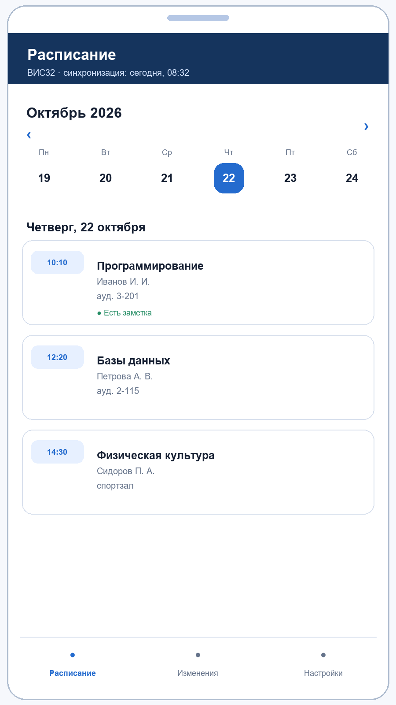
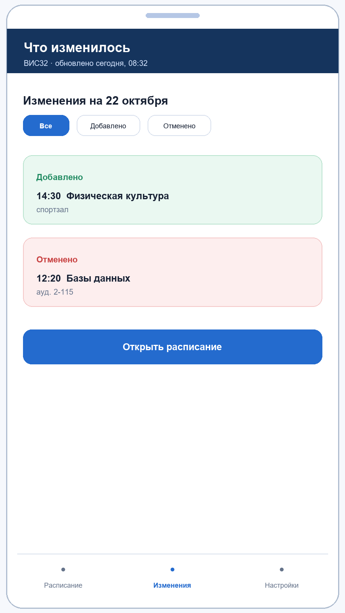
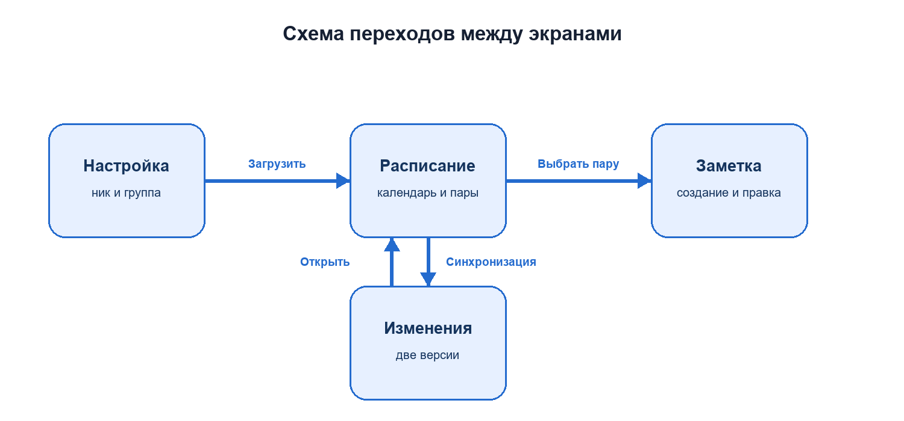
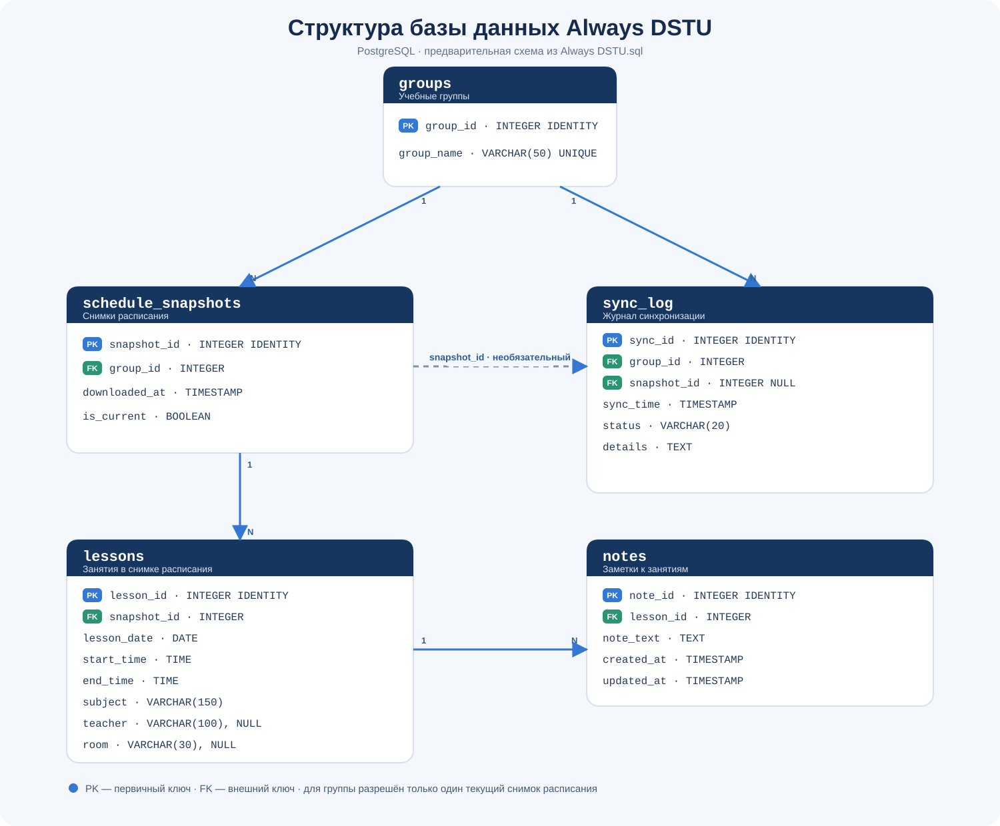

# Always DSTU

Учебный проект группы ВИС32 ДГТУ. Цель проекта — помочь студентам просматривать расписание и заметки даже без интернета, а после подключения сохранять актуальные данные и показывать изменения.

## Текущий этап

Для ЛР № 6 разрабатывается настольный прототип на Python 3.12 и Tkinter. Он получает расписание с сайта ДГТУ, сохраняет снимки в PostgreSQL для офлайн-просмотра, показывает пары выбранного дня, поддерживает заметки, сводку по расписанию и сравнение сохранённых версий. В профиле доступны выбор группы и светлая или тёмная тема. Мобильную версию будем рассматривать позже, после согласования с преподавателем.

Для общего контекста команды и плана ЛР6–ЛР7 см. [PROJECT_CONTEXT.md](PROJECT_CONTEXT.md).

## Канбан-доска команды

Актуальное состояние задач хранится в [KANBAN.html](KANBAN.html). Скачайте репозиторий и откройте этот файл в браузере, чтобы увидеть доску. На GitHub файл отображается как исходный HTML, без автоматически опубликованной страницы. Статусы меняются переносом блока карточки в нужную колонку и общим коммитом; автоматического совместного редактирования и перетаскивания карточек нет. Договоритесь, кто обновляет доску, и перед работой получайте последние изменения команды.

## Интерфейс проекта

Ниже — макеты, подготовленные на раннем этапе проекта для ЛР2. Это концепция интерфейса, а не скриншоты работающего настольного приложения. Реализованный настольный прототип находится в папке `AlwaysDSTU`.

| Первый запуск | Расписание |
|:---:|:---:|
|  |  |

| Заметка к занятию | Изменения в расписании |
|:---:|:---:|
|  |  |

Схема переходов между этими экранами:

<p align="center">
  
</p>

## Структура базы данных

Предварительная схема PostgreSQL из файла [`Always DSTU.sql`](Always%20DSTU.sql): учебные группы связаны со снимками расписания и журналом синхронизации; снимки содержат пары, а к паре можно добавить заметки.

<p align="center">
  
</p>

Для каждой группы база допускает только один актуальный снимок расписания; дополнительно остаётся предыдущая версия того же месяца для сравнения расписаний.

## Запуск прототипа

```powershell
cd AlwaysDSTU
python main.py
```

Подробная настройка PostgreSQL, установка драйвера и тестовый запуск описаны в [AlwaysDSTU/README.md](AlwaysDSTU/README.md).

## Состав репозитория

- `AlwaysDSTU/` — исходный код и инструкция по запуску настольного каркаса.
- `assets/` — визуальные материалы проекта: макеты экранов и схема базы данных.
- `PROJECT_CONTEXT.md` — общий контекст решений и план дальнейшей работы команды.
- `KANBAN.html` — доска задач, которую команда обновляет через Git.
- `ЛР1`–`ЛР6` — отчёты по лабораторным работам проекта.
- `Always DSTU.sql` — схема базы данных PostgreSQL.

Материалы преподавателя используются как справочные и не входят в репозиторий проекта.
