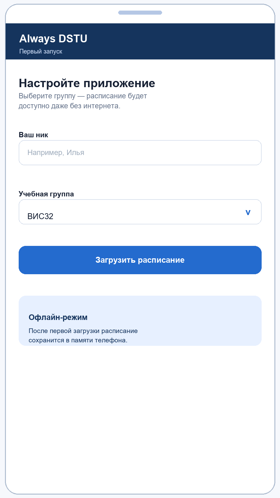
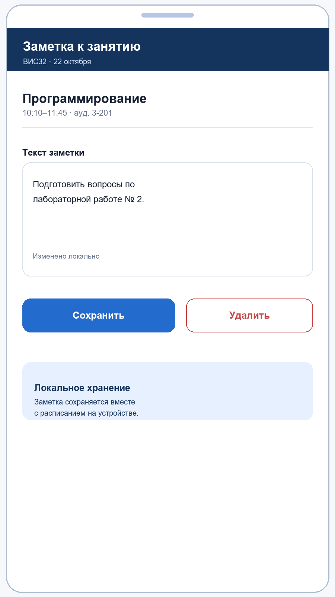

# Always DSTU

Учебный проект группы ВИС32 ДГТУ. Цель проекта — помочь студентам просматривать расписание и заметки даже без интернета, а после подключения сохранять актуальные данные и показывать изменения.

## Текущий этап

Подготовлен настольный каркас на Python 3.12 и Tkinter. Подключение PostgreSQL и реализация функций расписания запланированы на следующие этапы. Разработку мобильной версии будем рассматривать позже, после согласования с преподавателем.

## Интерфейс проекта

Ниже — макеты, подготовленные на раннем этапе проекта для ЛР2. Это концепция интерфейса, а не скриншоты работающего настольного приложения: текущий Tkinter-каркас пока не реализует эти экраны.

| Первый запуск | Расписание |
|:---:|:---:|
|  |  |

| Заметка к занятию | Изменения в расписании |
|:---:|:---:|
|  |  |

Схема переходов между этими экранами:

<p align="center">
  
</p>

## Структура базы данных

Предварительная схема PostgreSQL из файла [`Always DSTU.sql`](Always%20DSTU.sql): учебные группы связаны со снимками расписания и журналом синхронизации; снимки содержат пары, а к паре можно добавить заметки.

<p align="center">
  
</p>

Для каждой группы база допускает только один актуальный снимок расписания. История снимков нужна для последующего сравнения расписаний.

## Запуск каркаса

```powershell
cd AlwaysDSTU
python main.py
```

Tkinter входит в стандартную поставку Python для Windows; дополнительные пакеты для запуска каркаса не требуются.

## Состав репозитория

- `AlwaysDSTU/` — исходный код и инструкция по запуску настольного каркаса.
- `assets/` — визуальные материалы проекта: макеты экранов и схема базы данных.
- `ЛР1`–`ЛР5` — отчёты по лабораторным работам проекта.
- `Always DSTU.sql` — схема базы данных PostgreSQL.

Материалы преподавателя используются как справочные и не входят в репозиторий проекта.
